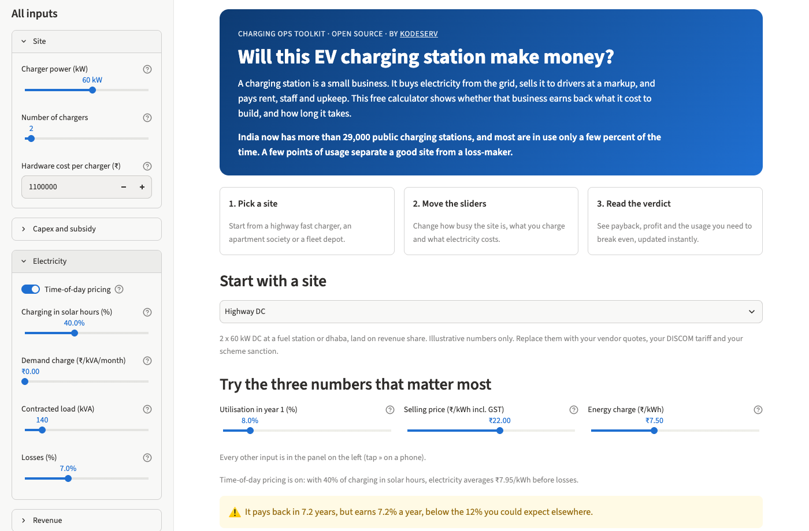

# CPO Business Case Calculator

Will an EV charging site in India pay back, and at what utilisation does it break even?

A free calculator for would-be charge point operators, property owners, fuel retailers and fleet
operators. Pick a preset, replace the numbers with your own, and see payback, breakeven utilisation,
NPV and IRR in a few seconds.

**Try it: [kodeserv-cpo-calculator.streamlit.app](https://kodeserv-cpo-calculator.streamlit.app/)**



> For estimation and learning. Not a certified compliance or financial tool. Every default is
> illustrative; replace it with your vendor quotes, your DISCOM tariff and your scheme sanction.

Part of the **Charging Ops Toolkit** by [Kodeserv](https://kodeserv.com).

## What it answers

- Is this site worth it after subsidy, and when do I get my money back?
- At what utilisation does it stop losing money?
- How much do price, utilisation, tariff and rent change the answer?

## Run it locally

Needs Python 3.12+ and [uv](https://docs.astral.sh/uv/).

```sh
git clone https://github.com/kodeserv/cpo-business-case-calculator.git
cd cpo-business-case-calculator
uv run streamlit run app/streamlit_app.py
```

Run the tests with `uv run pytest`.

## How it works

All maths lives in the `cpo_calc` package with no UI code; the Streamlit page only calls it.
For each year *t* of the project life:

| Quantity | Formula |
|---|---|
| Energy sold (kWh) | installed kW × 8,760 h × utilisation |
| Revenue excl. GST | energy × price incl. GST ÷ (1 + GST) |
| Payment fees | energy × price incl. GST × fee %, since gateways charge on what the driver pays |
| Revenue share | revenue excl. GST × share % |
| Energy cost | energy ÷ (1 − losses) × energy charge (blended for time of day, if on) |
| Fixed costs | demand charge × contracted kVA × 12 + O&M + CSMS + fixed rent + staff and other |
| EBITDA | revenue − fees − revenue share − energy cost + other income − fixed costs |

- **Utilisation** is energy-based, the measure most public reports use: energy delivered ÷
  (rated power × every hour of the year). It is not the time a car is plugged in, which reads
  higher. It grows by a fixed number of points each year until it reaches your maximum
  utilisation, and it can never exceed uptime.
- **Time-of-day pricing** (optional): public stations under the 2024 Ministry of Power guidelines
  pay 0.7× the energy charge from 9 am to 4 pm and 1.3× at other times. You set the share of
  charging that happens in solar hours, and the energy charge is blended accordingly.
- **Where each rupee goes:** the year-1 price per kWh is split into GST, fees, revenue share,
  electricity, fixed costs spread over the kWh sold, and the profit left.
- **Escalation:** the energy and demand charges rise with the tariff escalation; the selling price
  rises with the price escalation. Other costs stay flat.
- **Breakeven utilisation** is the year-1 utilisation at which EBITDA is zero (shown as not
  reachable if it is above your maximum utilisation):
  (fixed costs − other income) ÷ (rated kWh × margin per kWh).
- **Cash flow** is net capex (capex − subsidy) in year 0, then EBITDA each year.
  **Payback** is interpolated within the year. **NPV** uses your discount rate. **IRR** is
  found by bisection.
- **Scenarios:** pessimistic takes 70% of utilisation and 90% of price; optimistic 130% and 110%.
  The maximum utilisation stays as you entered it.

Worked year-1 numbers for each preset are in [`examples/hand_checked.md`](examples/hand_checked.md)
and are asserted to the rupee in the tests.

## Limits

- No debt, tax, depreciation or charger replacement: the cash flow is pre-tax and unlevered.
- One charger type per site in the form (the engine supports a mix).
- No live tariffs or subsidy rules; you enter both.
- No site selection, traffic or demand forecasting.

## Roadmap (v0.2)

Tornado sensitivity, PDF export, shareable links, a CLI, a readiness checklist (OCPP, OCPI, UPI,
charging guidelines), mixed charger types, and debt, tax and depreciation. See the
[v0.2 milestone](https://github.com/kodeserv/cpo-business-case-calculator/milestone/2).

## Feedback

Found a wrong formula or a better default? [Open an issue](https://github.com/kodeserv/cpo-business-case-calculator/issues).

## Licence

Apache 2.0. See [LICENSE](LICENSE).
